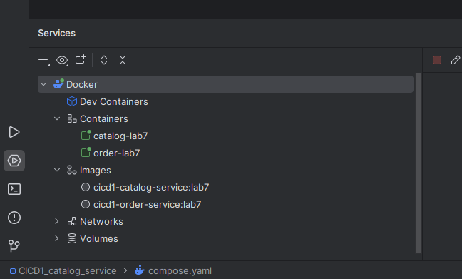

CICD1 Lab Work

Order Service :8083

Intended to run with Catalog Service :8082

Endpoints:

Retrieve orders: '/orders'

Create order: '/order/'

Test connection to Catalog Service: '/orders/test-catalog/{id}'

Get Product by Order: '/orders/{id}/product'

Wk2: Add JPA + H2 - Done

Wk3: Add OpenFeign communication with Catalog Service - Done

Lab 7 - Docker

Review Questions:
* Maven package must run first to create the jars that docker uses to build an image.
* An image is the java files ready to run, a container contains the OS that runs the java files.
* 8082:8082 configures any mention of 8082 in the jar/image to port 8082 in the container, EXPOSE 8082 is not enough as it merely makes it open to inputs.
* This is due to 8081 being a local port within the container.
* The Product persistence survived as we set up a volume which keeps database entities between containers, this contrasts with a H2 database, which is lost when the container is stopped.

